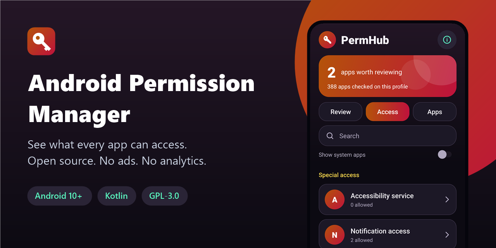
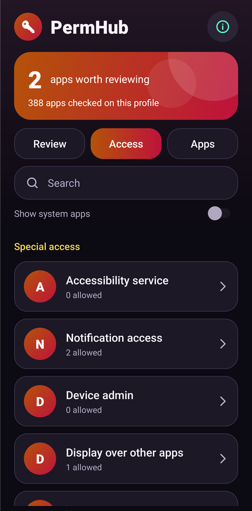
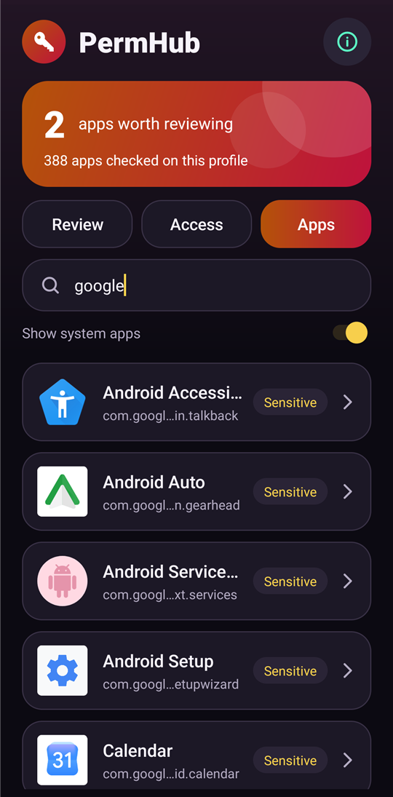
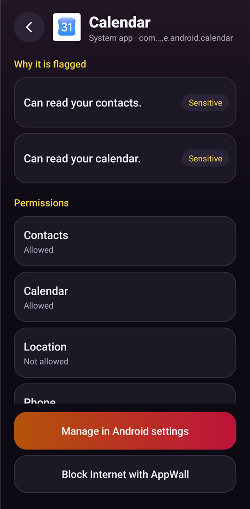
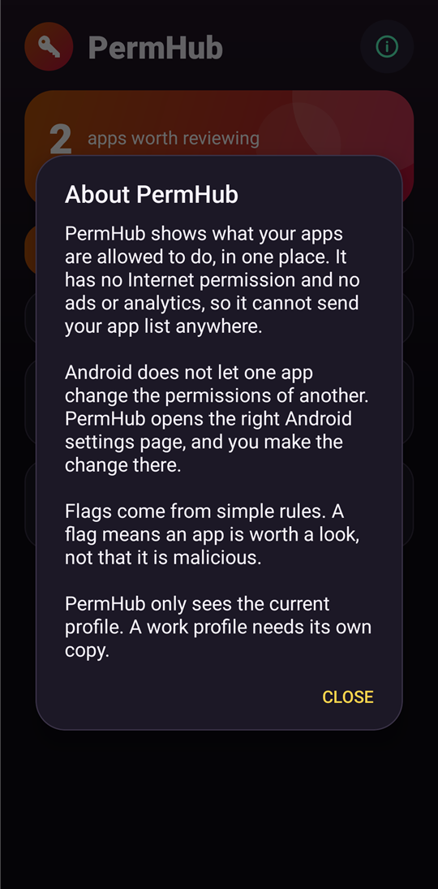

<div align="center">



# Android Permission Manager

**See what every Android app can access, in one place. Open source, no ads, no analytics.**

[](LICENSE)
[](#requirements)
[](https://kotlinlang.org)
[](app/build.gradle.kts)
[](app/src/main/AndroidManifest.xml)
[](https://github.com/Nekuzaky/android-permission-manager/stargazers)

</div>

Android Permission Manager ships an app called **PermHub**. It audits every app on your phone and gathers permissions and special access in one hub, with a direct link to the right Android settings page for each one.

PermHub has no Internet permission, so your list of apps stays on your phone.

## Screenshots

<p align="center">
  
  
  
  
</p>

## Features

- **Review:** apps that match a high-risk rule, with the reason in plain language
- **Access:** every permission and special access, with the number of apps allowed
- **Apps:** every app sorted by risk, with search and an option to include system apps
- **App details:** all findings, permissions and special access for one app
- **Direct links:** open the right Android settings page in one tap
- **AppWall link:** open [AppWall](https://github.com/Nekuzaky/android-app-firewall) to cut Internet access, when it is installed
- No ads, no analytics, no account and no third-party libraries

## What it checks

| Type | Items |
| --- | --- |
| Permissions | Microphone, camera, location, background location, contacts, phone, call log, SMS, calendar, photos and files, body sensors, nearby devices, notifications |
| Special access | Accessibility services, notification access, device admin, display over other apps, usage access, all files access, install unknown apps |

Nearby devices appear on Android 12 and later, and notifications on Android 13 and later, because these permissions do not exist before those versions.

## How flags work

Rules are simple and run on the device. There is no AI, no server and no database of known apps.

| Level | Examples |
| --- | --- |
| **Review** | Accessibility service, notification access, device admin, SMS, call log, background location, a simple utility or a game with unusual personal access |
| **Sensitive** | Microphone, camera, contacts, location, phone, calendar, display over other apps, usage access, all files access, install unknown apps |
| **Low** | Photos and files, body sensors, nearby devices, notifications |

A flag means an app is worth a look. It does not mean the app is malicious, and many legitimate apps need these permissions. System apps are never above **Sensitive**, and only your own apps count toward the review total.

## Why PermHub cannot change permissions itself

Android does not let one app change the permissions of another. This protects you from malicious apps. PermHub opens the right Android settings page, and you make the change there.

## Privacy

- No Internet permission, so PermHub cannot send your data online.
- Nothing is stored. Results are read from Android each time and kept in memory.

### Permissions

| Permission | Why it is needed |
| --- | --- |
| `QUERY_ALL_PACKAGES` | Android hides most installed apps from other apps without it, and an audit needs the full list |

## Requirements

- Android 10 (API 29) or later
- JDK 21 and Android SDK 35 to build from source

Gradle 8.11 does not support the Java 25 runtime bundled with recent Android Studio versions, so use a separate JDK 21.

## Download

Download the signed APK from the [latest release](https://github.com/Nekuzaky/android-permission-manager/releases/latest) and open it on your phone. Android may ask you to allow installs from the app you opened it with.

The release notes list the SHA-256 checksum of the APK and of its signing certificate.

## Build from source

A build signed with your own key cannot install over the release APK, so uninstall the app first.

```bash
git clone https://github.com/Nekuzaky/android-permission-manager.git
```

```bash
cd android-permission-manager
```

Create a `local.properties` file that points to your Android SDK:

```properties
sdk.dir=/path/to/Android/Sdk
```

Create a signing key, then add a `keystore.properties` file at the project root. It is ignored by Git, so never commit it or your key:

```properties
storeFile=/path/to/your-key.jks
storePassword=your-password
keyAlias=release
keyPassword=your-password
```

Build the release APK with JDK 21:

```bash
JAVA_HOME=/path/to/jdk-21 ./gradlew assembleRelease
```

Install it on a phone with USB debugging enabled:

```bash
adb install -r app/build/outputs/apk/release/app-release.apk
```

Run the unit tests:

```bash
JAVA_HOME=/path/to/jdk-21 ./gradlew testDebugUnitTest
```

## Limitations

- **No direct changes.** You change permissions in Android settings, not in PermHub.
- **One profile at a time.** PermHub only sees the current profile, so a work profile needs its own copy.
- **Rules are not a malware scan.** They only look at permissions, access and the app name or category.
- **No usage history.** PermHub shows what an app is allowed to do, not when it last used it.
- **Other permissions are not listed.** PermHub tracks the permissions in the table above, not every permission Android defines.
- **Not suited to the Play Store.** `QUERY_ALL_PACKAGES` is restricted, so the app is meant to be installed directly.
- **Device admin link.** Android has no public link to the device admin list, so PermHub opens the security settings.

## Test status

Tested on one device: Oppo Reno4 Z 5G (CPH2065) with Android 12 and ColorOS.

| Scenario | Status |
| --- | --- |
| Permission counts match `dumpsys` on all 88 third-party apps | Works, 12 categories compared |
| Overlay, usage, all files and install access match `appops` | Works |
| Enabled notification listeners match Android settings | Works |
| All special access links open the expected settings page | Works |
| App details and link to Android settings | Works |
| App removed while its details are open | Works |
| Landscape mode | Works |
| Direct launch of internal screens from ADB | Refused |
| 14,000 random interactions with the Android monkey tool, including rotations | No crash |
| Risk rules | Works, unit tests |
| Accessibility and device admin counts when an app has them | Not tested, none active on the test device |
| Notifications category on Android 13 and later | Not tested |
| Other phones and Android versions | Not tested |

Reports from other devices are welcome. Please open an issue with your phone model, Android version and what you saw.

## Related

- [Android App Firewall](https://github.com/Nekuzaky/android-app-firewall): cut Internet access per app.
- [Android App Duplicator](https://github.com/Nekuzaky/android-app-duplicator): run a second account of an app in a work profile.

## License

Distributed under the [GNU General Public License v3.0](LICENSE).
